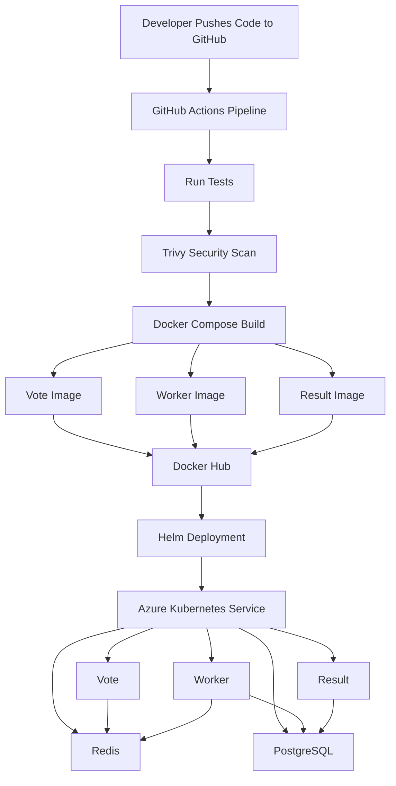

# Cloud-Native Voting Application

A production-style microservices voting application deployed on Azure Kubernetes Service (AKS) using Infrastructure as Code, CI/CD, containerization, Helm, and Kubernetes.

---

# Project Overview

This project demonstrates modern DevOps practices including:

- Infrastructure as Code using Terraform
- Containerization using Docker
- Multi-service orchestration using Docker Compose
- Kubernetes deployment on Azure AKS
- CI/CD with GitHub Actions
- Security scanning using Trivy
- Deployment management using Helm
- Container registry integration using Docker Hub

---

# Architecture



---

# Application Components

| Service    | Description                          |
| ---------- | ------------------------------------ |
| Vote       | Frontend voting application          |
| Worker     | Processes votes and updates database |
| Result     | Displays voting results              |
| Redis      | Vote queue                           |
| PostgreSQL | Persistent vote storage              |

---

# Technology Stack

## Infrastructure

- Microsoft Azure
- Azure Kubernetes Service (AKS)
- Terraform

## CI/CD

- GitHub Actions

## Containers

- Docker
- Docker Compose
- Docker Hub

## Orchestration

- Kubernetes
- Helm

## Security

- Trivy Vulnerability Scanner

---

# Infrastructure Deployment

Initialize Terraform:

```bash
terraform init
```

Validate configuration:

```bash
terraform validate
```

Plan deployment:

```bash
terraform plan
```

Deploy infrastructure:

```bash
terraform apply
```

Destroy infrastructure:

```bash
terraform destroy
```

---

# Docker Build

Build services locally:

```bash
docker compose build
```

Run locally:

```bash
docker compose up
```

---

# Kubernetes Deployment

Apply manifests:

```bash
kubectl apply -f k8s-specifications/
```

Check pods:

```bash
kubectl get pods
```

Check services:

```bash
kubectl get svc
```

---

# Helm Deployment

Install release:

```bash
helm upgrade --install vote ./helm/vote
```

View releases:

```bash
helm list
```

View revision history:

```bash
helm history vote
```

Rollback deployment:

```bash
helm rollback vote 1
```

---

# CI/CD Pipeline

The GitHub Actions workflow performs:

1. Source checkout
2. Tests execution
3. Trivy security scan
4. Docker image build
5. Docker image push
6. Azure authentication
7. AKS context configuration
8. Helm deployment

Pipeline File:

```text
.github/workflows/deploy.yaml
```

---

# GitHub Secrets

Required Secrets:

| Secret             | Purpose                 |
| ------------------ | ----------------------- |
| AZURE_CREDENTIALS  | Azure authentication    |
| DOCKERHUB_USERNAME | Docker Hub username     |
| DOCKERHUB_TOKEN    | Docker Hub access token |

---

# Docker Images

Images are stored in Docker Hub:

```text
device66/voting-app-vote
device66/voting-app-worker
device66/voting-app-result
```

---

# Verification Commands

Pods:

```bash
kubectl get pods
```

Services:

```bash
kubectl get svc
```

Nodes:

```bash
kubectl get nodes
```

---

# Learning Outcomes

This project demonstrates:

- Infrastructure as Code
- Containerization
- Kubernetes orchestration
- Azure cloud deployment
- GitHub Actions CI/CD
- Security scanning
- Helm package management
- Microservices architecture
- Cloud-native application delivery

---

# Author

Godwin-Techie
